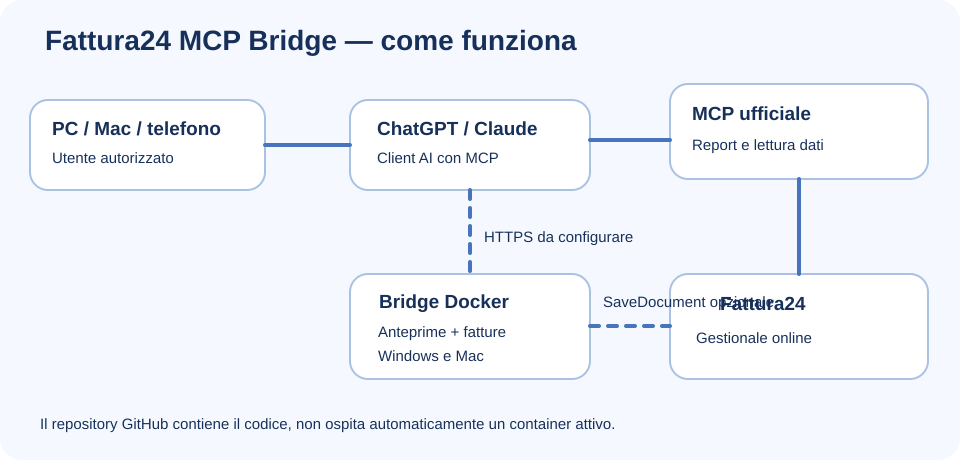
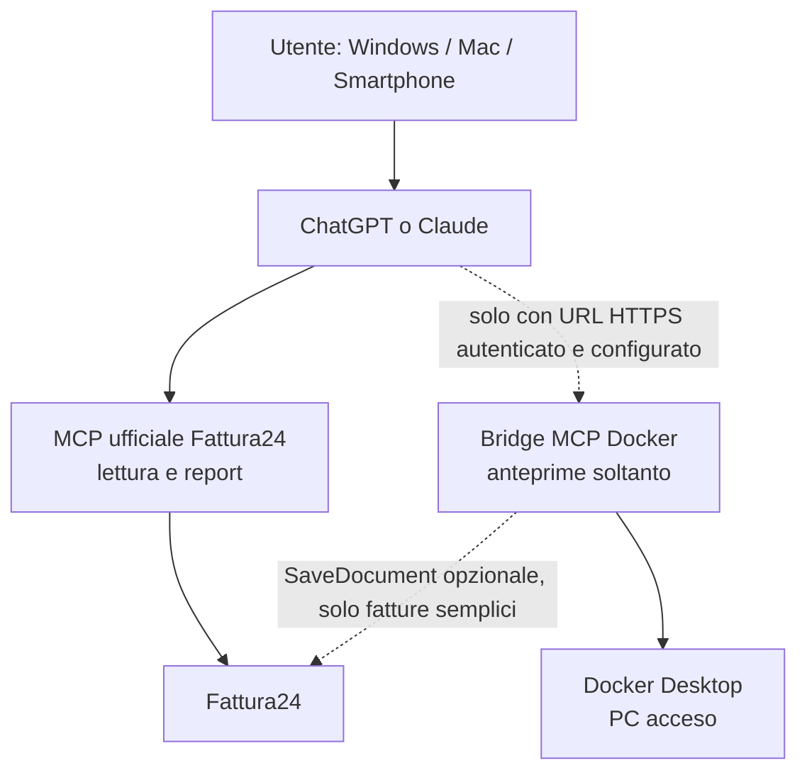
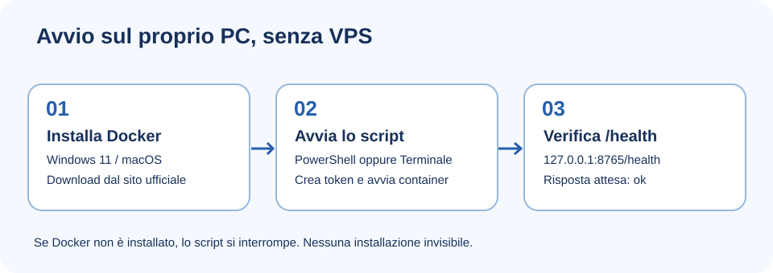
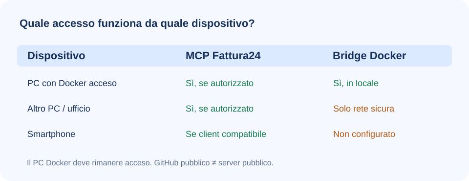

# Fattura24 MCP Bridge · ChatGPT + Claude + Docker

   

> **Progetto open source non ufficiale**, indipendente da Fattura24, OpenAI e Anthropic. La modalità predefinita è **sola anteprima**. Include adesso anche una **prima integrazione di scrittura reale per fatture semplici** tramite API ufficiali, disattivata finché l'utente non abilita esplicitamente le operazioni. DDT, invio SdI, automazione di Docker da ChatGPT e accesso remoto non sono completati.



## 🎯 A cosa serve?

Vuoi chiedere a un assistente AI: *«Preparami una fattura per 10 unità a 25 euro + IVA»*, controllare i totali e ottenere un'anteprima senza aprire decine di schermate. Questo repository contiene un piccolo **server MCP** avviabile con Docker Desktop su Windows o Mac, istruzioni per ChatGPT e una skill per Claude.

**Attenzione:** la funzionalità di analisi dei dati contabili è già disponibile tramite **il server MCP ufficiale Fattura24**, separato dal bridge. Il server ufficiale è prevalentemente di sola lettura. Il bridge supporta anche il salvataggio REST opzionale di **fatture semplici** quando configurato e attivato; resta necessario il controllo dei documenti nell'interfaccia ufficiale.

### Cosa funziona

| Operazione | Situazione |
| --- | --- |
| Analisi fatturato, IVA e incassi | Tramite [MCP ufficiale Fattura24](https://www.fattura24.com/mcp/perche-usarlo/), con autorizzazione al proprio account |
| Controllo stato del container | ✅ |
| Anteprima imponibile, IVA e totale | ✅ |
| Anteprima XML esemplificativo | ✅ — **non** è un XML fiscale certificato |
| Preparazione dati DDT | ✅ solo appunti |
| Registrare fatture in Fattura24 | 🧪 Prima implementazione SaveDocument, **opt-in**, con conferma esplicita e anti-duplicati; non collaudata su account reale |
| Registrare DDT in Fattura24 | ⚠️ Non supportato dall'endpoint SaveDocument documentato. Serve integrazione con interfaccia web supportata oppure funzionalità ufficiale aggiuntiva |
| Invio automatico allo SdI | ❌ non supportato |
| ChatGPT apre Docker Desktop da solo | ❌ non può controllare il PC senza agente locale autorizzato |
| Accesso smartphone al container | ❌ non configurato: serve PC acceso, accesso remoto HTTPS e autenticazione |

## 🧩 Come sono collegati i componenti






## ⚡ Avvio senza Git, senza clone e senza Compose (Windows / Mac)

L'immagine Docker GHCR viene **scaricata e avviata automaticamente da un launcher locale**. Il launcher fa parte del repository ma non devi clonarlo: può essere scaricato come un singolo script. Le skill istruiscono il rispettivo assistente a farlo **quando dispone realmente di una shell locale autorizzata**.

**Windows PowerShell** — scarica il launcher, controllalo, eseguilo:

```powershell
$script = Join-Path $env:TEMP 'fattura24-launch.ps1'
Invoke-WebRequest 'https://raw.githubusercontent.com/gzileni/https-www.fattura24.com-mcp-perche-usarlo-/main/scripts/launch-standalone.ps1' -OutFile $script
notepad $script
powershell -ExecutionPolicy Bypass -File $script
```

**Mac Intel / Apple Silicon** — scarica il launcher, controllalo, eseguilo:

```bash
curl -fL 'https://raw.githubusercontent.com/gzileni/https-www.fattura24.com-mcp-perche-usarlo-/main/scripts/launch-standalone.sh' -o /tmp/fattura24-launch.sh
cat /tmp/fattura24-launch.sh
bash /tmp/fattura24-launch.sh
```

**Comportamento:** verifica se Docker Desktop è installato; se è spento tenta di avviarlo; se il container `fattura24-mcp` è già presente, lo lascia attivo (o lo riavvia, senza sovrascrivere il token). In assenza del container, esegue `docker pull ghcr.io/gzileni/fattura24-mcp-bridge:latest` e `docker run`, configura `127.0.0.1:8765`, crea il token privato persistente e lascia disabilitate le scritture. I token si trovano in `%LOCALAPPDATA%\Fattura24MCP\bridge.env` (Windows) e `~/.config/fattura24-mcp/bridge.env` (Mac), **non** nel repository e non nella chat.

**Se il container è già in esecuzione da un avvio manuale, non è necessario ricrearlo.** La sostituzione volontaria richiede il parametro `-ReplaceExisting` (Windows) o `--replace-existing` (Mac); non usarlo finché non hai verificato il contenuto e la persistenza delle credenziali del container esistente.

**Claude Code locale:** la skill [`.claude/skills/fattura24/SKILL.md`](.claude/skills/fattura24/SKILL.md) indica di scaricare e avviare automaticamente lo script, previo consenso a eseguire shell. **ChatGPT plugin cloud:** la skill [`chatgpt-plugin/skills/fattura24-workflow/SKILL.md`](chatgpt-plugin/skills/fattura24-workflow/SKILL.md) applica lo stesso flusso **solo se esiste un esecutore locale autorizzato**: il plugin ChatGPT standard non dispone automaticamente di PowerShell o Terminale. L'avvio locale del container e la connessione al cloud ChatGPT restano due operazioni distinte.

**Verifica:** `curl.exe http://127.0.0.1:8765/health` (Windows) oppure `curl http://127.0.0.1:8765/health` (Mac). Risposta attesa: `ok`.

## 💶 Aruba VPS: quanto costa tenere Fattura24 MCP online 24/7?

Ho aggiunto una [**analisi dei costi Aruba VPS con prezzi ufficiali e scenari concreti**](docs/ARUBA_VPS_COSTI.md), verificata il **14 novembre 2026**. Per un singolo bridge con Docker e margine per un reverse proxy, il punto di partenza consigliato è **Aruba Cloud VPS O2A4 (2 vCPU, 4 GB): 6,29 € + IVA/mese**, cioè circa **7,67 € IVA inclusa**. In caso di futura automazione browser per i DDT, valutare **O4A8 (4 vCPU, 8 GB): 11,79 € + IVA/mese**. Sono valori di listino senza promozioni e **non includono** dominio, backup esterno, configurazione sicura e manutenzione.

**Attenzione:** l'immagine Docker è distribuibile, ma non è ancora un servizio MCP pubblico pronto per la produzione: la configurazione attuale è solo locale. Il documento illustra l'architettura remota consigliata, il confronto con il PC acceso e una checklist di sicurezza, senza suggerire di pubblicare la porta 8765 o il semplice token Bearer su Internet.

## 📦 Immagine pubblicata su GitHub Container Registry (GHCR)

GitHub **Packages / Container Registry** è il registro delle immagini Docker. Non è un server su cui girano i container: ospita un'immagine da scaricare. Il workflow [publish-ghcr.yml](.github/workflows/publish-ghcr.yml) costruisce e pubblica l'immagine per **Linux/amd64** (Docker Desktop su Windows e Mac Intel) e **Linux/arm64** (Mac Apple Silicon), usando solo il `GITHUB_TOKEN` di GitHub Actions.

**Nome immagine:** `ghcr.io/gzileni/fattura24-mcp-bridge:latest`.

Al primo caricamento, verifica la visibilità del pacchetto su GitHub → profilo → Packages → fattura24-mcp-bridge → Package settings: se risulta privato, imposta **Public**. Non ho modificato le impostazioni del tuo account. Verifica la pagina Packages prima di dichiararlo scaricabile senza login.

**Deploy locale (non servono Python né compilazione sul PC):**

- Windows PowerShell: `powershell -ExecutionPolicy Bypass -File .\scripts\start.ps1`
- macOS Intel o Apple Silicon: `bash ./scripts/start-mac.sh`
- Alternativa: `docker compose pull && docker compose up -d --no-build` dopo aver creato un file `.env` con il token privato.

Gli script verificano Docker, tentano di avviare Docker Desktop se installato ma non attivo, creano un token casuale locale, **scaricano l'immagine pubblicata** e avviano il container. **Non installano Docker Desktop automaticamente**, non aprono le porte su Internet e non attivano le scritture nel gestionale.

### 🤖 Avvio dalla skill di Claude Code

La skill `.claude/skills/fattura24/SKILL.md` contiene istruzioni per Claude Code: in una **sessione locale**, dopo aver ottenuto l'autorizzazione a eseguire shell, Claude può lanciare lo script del sistema operativo e collegare il server MCP all'ambiente locale. Questo è un comando locale approvato, **non** un privilegio concesso automaticamente al modello. Claude Web e l'app mobile non possono avviare Docker sul PC spento.

### 🖥️ Avvio dal plugin ChatGPT

Il plugin ChatGPT remoto non può **autonomamente** accendere Docker Desktop o scaricare immagini sul PC: per l'avvio locale servono una sessione desktop con esecutore locale approvato o l'esecuzione manuale dello script. Il server è collegabile localmente dagli host MCP compatibili; per ChatGPT cloud si usa un **Secure MCP Tunnel** autorizzato, non l'URL `127.0.0.1`. La documentazione OpenAI prevede restrizioni e autorizzazioni per la distribuzione dei plugin desktop con MCP locale. Non dichiarare che un pacchetto GitHub installi un plugin ChatGPT sul tuo account.

### 🔐 Nota importante sul deploy

Non esporre il bridge a Internet tramite `ports: "8765:8765"`. Il server locale utilizza un Bearer token statico, non un'autenticazione OAuth completa per MCP pubblico. Anche se il pacchetto GHCR è pubblico, il container deve rimanere protetto su `127.0.0.1`. Le funzioni di scrittura su fatture e clienti vanno attivate solo dopo prove e approvazione, su un account controllato.

Fonti: [GitHub Docs — publish Docker images](https://docs.github.com/en/actions/tutorials/publish-packages/publish-docker-images), [OpenAI — MCP servers](https://learn.chatgpt.com/docs/extend/mcp), [OpenAI — desktop-only plugins](https://developers.openai.com/plugins/deploy/desktop-only), [Claude Code — skill e MCP](https://support.claude.com/en/articles/14554922-claude-code-user-faq).

## ✅ Requisiti

**Windows:** Windows 11, Docker Desktop con WSL2 attivo, PowerShell e connessione Internet per scaricare l'immagine base. **Mac:** macOS compatibile, Docker Desktop per chip Intel o Apple Silicon, Terminale. **Non serve** una chiave API OpenAI, né un VPS. Il piano Fattura24 può limitare la disponibilità delle sue API.

Docker Desktop deve essere installato **prima** di avviare il progetto. Se non c'è, lo script si ferma; non installa software senza consenso.

## 🚀 Avvio in 3 passaggi

### Windows 11

1. Installa [Docker Desktop](https://docs.docker.com/desktop/setup/install/windows-install/) e avvialo la prima volta.
2. Scarica il repository come ZIP (pulsante **Code → Download ZIP**) e apri PowerShell nella cartella estratta.
3. Esegui:

```powershell
powershell -ExecutionPolicy Bypass -File .\scripts\start.ps1
curl.exe http://127.0.0.1:8765/health
```

Se vedi **ok** il container risponde. Lo script crea un token locale nel file `.env`, che non deve essere pubblicato. Arresta con `powershell -File .\scripts\stop.ps1`.

### macOS (Intel e Apple Silicon)

1. Installa [Docker Desktop per Mac](https://docs.docker.com/desktop/setup/install/mac-install/) per il processore corretto.
2. Apri Terminale nella cartella scaricata.
3. Esegui:

```bash
bash ./scripts/start-mac.sh
curl -fsS http://127.0.0.1:8765/health
```

Arresta con `bash ./scripts/stop-mac.sh`.

### Senza script (Windows, Mac, Linux con Docker già avviato)

Crea `.env` copiando `.env.example` e **sostituisci** il valore `BRIDGE_TOKEN` con una stringa casuale lunga; poi:

```bash
docker compose pull && docker compose up -d --no-build
docker compose ps
docker compose logs --tail=50
```

Usa solo dati fittizi durante i test. Docker pubblica il servizio **esclusivamente** su `127.0.0.1:8765`.

## 🧾 Salvataggio reale di fatture (funzione sperimentale, disattivata per sicurezza)

**Novità:** il Docker include `fattura24_client.py`, che utilizza l'endpoint ufficiale `POST /api/v0.3/SaveDocument` per **fatture semplici** di tipo `I` (analogica) oppure `FE` (elettronica). Il salvataggio crea il documento nell'account Fattura24, **non** lo invia allo SdI. Fatture con ritenute, casse, reverse charge, altri regimi speciali e casistiche complesse richiedono verifiche e possono non essere gestite da queste API. I DDT non sono ancora registrabili automaticamente dal bridge. Documentazione: [creare documento](https://www.fattura24.com/api/crea-documento/) e [fattura elettronica](https://www.fattura24.com/api/crea-fattura-elettronica/).

**Prima di attivarlo:** leggi il [regolamento API Fattura24](https://www.fattura24.com/documentazione-legale/regolamento-api/) che richiede un ambiente di test e controllo manuale. Crea prima documenti di prova **sul tuo account** e verifica gli esiti. Non effettuare test di scrittura con documenti che non vuoi registrare.

**Configurazione:** apri il file locale `.env` (creato dallo script di avvio). Aggiungi:

```dotenv
FATTURA24_API_KEY=LA_TUA_CHIAVE_FATTURA24
FATTURA24_ENABLE_WRITES=true
```

La chiave si genera in **Fattura24 → Configurazione → App e servizi esterni → API**, se prevista dal tuo piano. Non confonderla con le API OpenAI. **Non metterla su GitHub, in ChatGPT o nella skill**. Ricarica il container con `docker compose up -d --force-recreate`.

La chiamata `save_invoice_to_fattura24` è accessibile solo via MCP protetto dal token locale; richiede **l'anteprima del documento, una conferma esplicita dell'utente**, la stringa `CONFERMO IL SALVATAGGIO IN FATTURA24` e un `request_id` unico per quel tentativo. Lo stesso identificatore non genera una seconda fattura. In caso di timeout/errore ambiguo l'operazione resta marcata **uncertain**: **non riprovare automaticamente**; controlla Fattura24 per evitare duplicati. Lo storico tecnico anti-duplicati è conservato nel volume Docker `fattura24_state`. Non eliminare quel volume quando riavvii.

Lo strumento `invoice_api_payload_preview` restituisce il vero payload XML **SaveDocument** (non XML FatturaPA) che l'API riceverebbe. `invoice_xml_preview`, invece, resta l'esempio generico e non deve essere inviato all'API.

**Limiti attuali:** nessuna automazione SdI, nessun PDF generato dal bridge, nessun browser gestito per DDT. La guida Fattura24 prevede che l'invio delle fatture elettroniche allo SdI avvenga **dall'interfaccia Fattura24**. Questa implementazione non è stata collaudata con credenziali reali; gli strumenti sono sottoposti a test unitari e ai controlli GitHub Actions, non a una certificazione fiscale.

## 🔬 Collaudo automatico sul tuo computer (senza creare fatture)

Questo è **il primo test pratico da eseguire** dopo l'avvio con `start.ps1` (Windows) oppure `start-mac.sh` (Mac). Verifica che l'immagine Docker non si limiti ad avviarsi, ma risponda davvero attraverso il protocollo MCP.

**Windows — PowerShell:**
```powershell
python .\scripts\smoke_test.py
```

**Mac — Terminale:**
```bash
python3 ./scripts/smoke_test.py
```

Per questo test occorre Python sul computer (non serve per far girare il servizio Docker). Se preferisci evitare Python locale, consulta il job `mcp-integration` in **GitHub → Actions → Tests**: GitHub esegue automaticamente lo stesso test in un container, senza chiavi Fattura24.

Il test interroga `/health`, verifica che il server rifiuti richieste MCP senza token, inizializza una sessione MCP, legge l'elenco degli strumenti e invoca `prepare_invoice` con **dati inventati**. Non usa chiavi API né invia richieste a Fattura24. Il risultato atteso è `TUTTI I CONTROLLI SUPERATI`.

In caso di errore, copia **solo il messaggio finale senza token** e verifica:

```bash
docker compose ps
docker compose logs --tail=100
```

**Il collaudo sul tuo PC non può essere eseguito dal cloud ChatGPT.** Gli script devono essere avviati sul sistema dove è installato Docker Desktop. Un test GitHub Actions riuscito conferma l'ambiente CI Linux, non Windows/macOS.

## 🧪 Verificare che funzioni

```bash
curl http://127.0.0.1:8765/health
```

Per usare gli strumenti MCP `bridge_status`, `prepare_invoice`, `invoice_xml_preview` e `prepare_ddt_notes`, occorre un **client MCP locale** che supporti Streamable HTTP e l'header `Authorization: Bearer <BRIDGE_TOKEN>`. L'URL MCP è `http://127.0.0.1:8765/mcp`. Non incollare il token in ChatGPT o nei ticket pubblici.

Esempio di dati JSON **fittizi** per una bozza:

```json
{
  "document_type": "FE",
  "customer_name": "Cliente di prova",
  "rows": [{
    "description": "Prodotto dimostrativo",
    "quantity": "10",
    "price_net": "25.00",
    "vat_code": "22",
    "vat_description": "22%"
  }]
}
```

Imponibile dimostrativo €250,00; IVA €55,00; totale €305,00 (esempio aritmetico, non controllo fiscale).

### Test automatici

```bash
python -m pip install -r requirements-dev.txt
python -m pytest -q
```

Oppure usa GitHub Actions (workflow incluso) dopo il primo commit.

## 🤖 ChatGPT e Claude

- **ChatGPT**: la configurazione installabile del connettore ufficiale è in [`chatgpt-plugin/`](chatgpt-plugin/). Il bridge locale **non** è raggiungibile dal cloud con `localhost`: la connessione da ChatGPT richiede un URL HTTPS pubblico o una soluzione di accesso supportata, autenticazione appropriata e ulteriori verifiche. Il plugin privato precedentemente creato è [Fattura24 AI Assistant](https://chatgpt.com/plugins/plugins_6af8321d4cb8819187762bb1ba6ada06), **non automaticamente collegato a questo container**.
- **Claude**: istruzioni in [`.claude/skills/fattura24/SKILL.md`](.claude/skills/fattura24/SKILL.md), utilizzabili come guida; l'effettiva disponibilità degli strumenti MCP dipende dal client e dalla sua configurazione.
- **Skill portabile**: [`skills/fattura24/SKILL.md`](skills/fattura24/SKILL.md).



| Dove sei? | MCP ufficiale | Bridge Docker |
| --- | --- | --- |
| PC sul quale gira Docker | In ChatGPT/Claude se collegato | Usabile con client MCP **locale** |
| Altro PC | Sì, con account autorizzato | Solo dopo accesso remoto sicuro |
| Smartphone | Sì, se il client supporta il connettore | Non ancora; richiede un endpoint HTTPS autenticato |
| PC spento | Sì, il servizio ufficiale è remoto | **No** |

**Non aprire la porta 8765 sul router**. GitHub pubblico pubblica *codice*, non pubblica automaticamente un server. Una VPN da sola non assicura che un client AI cloud possa raggiungere un endpoint privato.

## 📂 Struttura dei file

```text
.
├── Dockerfile                 # Immagine Python multipiattaforma
├── compose.yaml               # Immagine GHCR, porta accessibile solo dal PC
├── server.py                  # MCP con protezione Bearer
├── core.py                    # Modelli e calcoli anteprima
├── fattura24_client.py        # SaveDocument API opt-in, senza ritentativi automatici
├── scripts/start.ps1          # Windows: controlla/apre Docker
├── scripts/start-mac.sh       # Mac: controlla/apre Docker
├── chatgpt-plugin/            # Plugin portabile, MCP ufficiale
├── .claude/skills/fattura24/  # Skill Claude
├── skills/fattura24/          # Skill condivisa
├── docs/images/               # Diagrammi SVG originali
├── tests/                     # Test automatici
├── SECURITY.md                # Sicurezza
└── LICENSE                    # MIT
```

## 🔐 Sicurezza

- La chiave API Fattura24 **non è necessaria** per la funzione di sola anteprima e non deve comparire nel repository.
- Non usare credenziali o dati personali reali negli esempi o nei commit.
- In caso di timeout durante una futura creazione di fatture, non ritentare alla cieca: rischio duplicazione/numerazione.
- Qualsiasi futura scrittura richiederà un pannello locale di approvazione, test isolati e verifica manuale. Nessuna promessa di invio automatico SdI.
- Leggi [SECURITY.md](SECURITY.md) e le condizioni ufficiali prima di integrare le API.

## 📚 Fonti ufficiali e normative tecniche

Le fonti seguenti sono documentazione **del fornitore**, non una certificazione di questo progetto.

1. [Fattura24 — Perché MCP](https://www.fattura24.com/mcp/perche-usarlo/)
2. [Fattura24 — Tool MCP disponibili](https://www.fattura24.com/mcp/toolDisponibili/)
3. [Fattura24 — Riferimento tecnico MCP](https://www.fattura24.com/mcp/riferimento-tecnico/)
4. [Fattura24 — Creare un documento via API REST](https://www.fattura24.com/api/crea-documento/)
5. [Fattura24 — Regolamento API](https://www.fattura24.com/documentazione-legale/regolamento-api/) — limiti, sicurezza, test, niente chiamate concorrenti e invio SdI manuale.
6. [Model Context Protocol](https://modelcontextprotocol.io/)
7. [Docker Desktop](https://docs.docker.com/desktop/)
8. [OpenAI — Apps SDK / MCP](https://developers.openai.com/apps-sdk/)
9. [Anthropic — Claude Code Skills](https://code.claude.com/docs/en/skills)

## ⚖️ Licenza e marchi

Codice e diagrammi originali sotto [licenza MIT](LICENSE). Il nome **Fattura24** è un marchio del relativo titolare. L'uso del nome serve a identificare il servizio interoperabile; **non** implica partnership o approvazione.


## 📇 Rubrica clienti, verifica API e PDF — estensioni

Il Docker include tre ulteriori operazioni basate su API **documentate**:

- `verify_fattura24_api_key`: chiama `TestKey` **soltanto su richiesta esplicita**, mai come sonda di disponibilità.
- `customer_payload_preview` e `save_customer_to_fattura24`: crea **oppure aggiorna** una scheda cliente tramite `SaveCustomer`; richiede `FATTURA24_ENABLE_WRITES=true`, `request_id` unico e la frase **CONFERMO CREAZIONE O AGGIORNAMENTO CLIENTE** dopo l'anteprima. Fattura24 può aggiornare un cliente già esistente, quindi non è una prova innocua.
- `download_document_pdf`: scarica il PDF già creato, tramite `GetFile` e `docId`. Per ragioni di riservatezza, il risultato contiene il documento codificato base64; non mostrarlo per intero in chat e non inserirlo nei log.

Fonti: [TestKey](https://www.fattura24.com/api/verifica/), [SaveCustomer](https://www.fattura24.com/api/crea-contatto/), [GetFile](https://www.fattura24.com/api/download-pdf/).

**Limiti espliciti:** la generazione di PDF di DDT o la compilazione del gestionale tramite un browser automatizzato non sono ancora presenti. Anche una futura automazione browser richiederà una sessione autenticata sul dispositivo sotto controllo dell'utente e test sulla UI reale. Non esiste un metodo per attivare un server Docker spento da un plugin cloud senza un agente locale o un sistema remoto già operativo.
