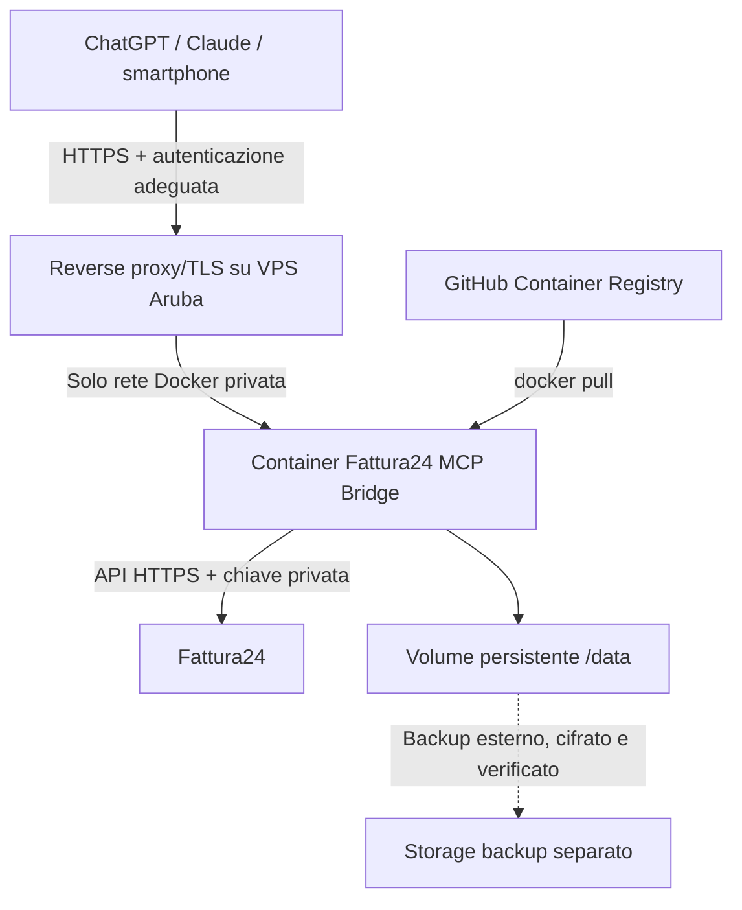

# Analisi dei costi: Fattura24 MCP Bridge su Aruba Cloud VPS

> **Aggiornato: 14 novembre 2026.** Preventivo indicativo, non un'offerta commerciale. I prezzi di listino sono quelli pubblicati da Aruba Cloud alla data della verifica, **senza promozioni**, **IVA esclusa**. Le cifre IVA inclusa sono calcolate ipotizzando **IVA italiana al 22%**. Prezzi, disponibilità, fatturazione e servizi accessori vanno confermati prima dell'acquisto.

## In parole semplici

Per usare Fattura24 MCP Bridge da ChatGPT/Claude e smartphone senza lasciare il PC acceso puoi tenere Docker su un **server virtuale Aruba VPS attivo 24 ore su 24**. GitHub Container Registry conserva l'immagine, Aruba fa girare il container. Un VPS, tuttavia, **non risolve da solo** l'integrazione con ChatGPT: servono HTTPS, un'autenticazione remota robusta e la corretta registrazione del server MCP nel client.

**Nota di sicurezza importante:** il `docker run` locale del progetto ascolta soltanto su `127.0.0.1:8765` e usa un semplice Bearer token. È **inadatto a essere esposto direttamente su Internet**. Non limitarti a rimuovere `127.0.0.1` o aprire la porta 8765. Per un deploy remoto servono almeno reverse proxy HTTPS, identità e controllo degli accessi adeguati, logging privo di dati sensibili, backup e collaudo; per un connettore ChatGPT cloud verificare i requisiti OAuth/connector del prodotto.

## Prezzi VPS ufficiali, senza promozioni

Fonte: [listino Aruba VPS OpenStack](https://www.arubacloud.com/pricing/bare-metale-vps/vps-server-virtuali-privati) e [schede VPS Aruba](https://www.arubacloud.com/vps/). Le risorse riportate sono **Linux**, senza Windows Server. La colonna "con IVA" è un calcolo, non il prezzo visualizzato da Aruba.

| Piano Aruba | CPU | RAM | Disco | Traffico dichiarato | €/mese + IVA | €/mese IVA 22% inclusa | €/anno + IVA (12 mesi) |
| --- | ---: | ---: | ---: | ---: | ---: | ---: | ---: |
| Cloud VPS O1I1 Starter | 1 vCPU | 1 GB | 20 GB | 2 TB/mese | **2,49 €** | **3,04 €** | **29,88 €** |
| Cloud VPS O1I2 Starter | 1 vCPU | 2 GB | 40 GB | 5 TB/mese | **4,49 €** | **5,48 €** | **53,88 €** |
| Cloud VPS O2A4 | 2 vCPU | 4 GB | 40 GB | 25 TB/mese | **6,29 €** | **7,67 €** | **75,48 €** |
| Cloud VPS O4A8 | 4 vCPU | 8 GB | 80 GB | 50 TB/mese | **11,79 €** | **14,38 €** | **141,48 €** |
| Cloud VPS O8A16 | 8 vCPU | 16 GB | 160 GB | 100 TB/mese | **19,89 €** | **24,27 €** | **238,68 €** |

Le offerte VPS indicano un indirizzo IPv4 pubblico e un collegamento fino a 1 Gbit/s. Verificare in fase d'ordine limiti di traffico, risorse realmente disponibili e condizioni del piano. Questi sono prezzi ricorrenti di listino; non implicano assistenza sistemistica gestita né costi di acquisto di domini o servizi aggiuntivi.

### Quale dimensione scegliere per questo progetto?

- **Test solo MCP Python senza browser:** O1I2 (1 vCPU/2 GB) può essere un punto di partenza economico, *da misurare*: 2 GB possono essere stretti per aggiornamenti e servizi collaterali.
- **Unico bridge, Docker + reverse proxy HTTPS + un po' di margine:** **O2A4 (2 vCPU/4 GB)** è il **dimensionamento iniziale consigliato**, non un benchmark garantito. Costo di listino **6,29 € + IVA al mese**, cioè circa **7,67 € IVA inclusa**.
- **Eventuale browser headless per i DDT, automazioni più complesse o più sessioni contemporanee:** valutare **O4A8 (4 vCPU/8 GB)**, circa **11,79 € + IVA/mese**, solo quando l'automazione browser sarà effettivamente implementata e testata. La maggiore RAM non rende di per sé i DDT disponibili.
- **O1I1 (1 GB):** sconsigliato per un endpoint contabile da usare continuativamente, salvo test molto limitati.

## Qual è il costo complessivo?

La fattura Aruba del VPS non è il costo totale del progetto. Ecco tre **scenari esemplificativi** basati sui prezzi di listino, distinguendo le spese certe dalle ipotesi.

| Scenario | VPS | Canone VPS annuo IVA esclusa | Extra da preventivare | Utilizzo |
| --- | --- | ---: | --- | --- |
| **Prova tecnica** | O1I2 | **53,88 €** | dominio se non disponibile; eventuale backup | Verificare Docker e endpoint MCP prima di esporli |
| **Bridge remoto essenziale (consigliato)** | O2A4 | **75,48 €** | dominio/DNS, backup esterno, protezione accessi e manutenzione | Una piccola installazione Linux 24/7 |
| **Sviluppo browser/DDT più pesante** | O4A8 | **141,48 €** | stessi extra, più impegno operativo | Solo se la futura automazione browser lo richiede |

### Costi aggiuntivi da considerare

| Voce | Quanto | Note |
| --- | --- | --- |
| **Docker Engine + Docker Compose** | Licenze software generalmente **0 €** su Linux | Installazione e manutenzione amministrate dall'utente; verificare licenze delle singole immagini |
| **Immagine su GitHub Container Registry** | Non conteggiata come canone VPS | La pubblicazione GitHub è configurata; eventuali limiti di account/registro vanno verificati nelle condizioni GitHub |
| **Ubuntu/Debian** | **0 € di licenza OS** | Su VPS Linux, salvo servizi gestiti aggiuntivi |
| **Certificato HTTPS Let's Encrypt** | **0 € per il certificato** | Richiede dominio o altro metodo compatibile e gestione del rinnovo; il reverse proxy non è attualmente implementato nel repository |
| **Dominio / DNS** | **Variabile, non incluso** | Puoi usare un dominio che già possiedi; non è necessario inventare un prezzo |
| **Backup su destinazione indipendente** | **Variabile** | Il volume Docker contiene lo storico anti-duplicati; la perdita può comportare rischi operativi |
| **Snapshot VPS Aruba** | Aruba documenta snapshot gratuiti per Cloud VPS, ma con **retention di 48 ore** per la procedura descritta | **Non sostituisce un backup storico**: verifica sempre il piano e la politica applicabile |
| **Configurazione OAuth / sicurezza / test / aggiornamenti** | **Tempo di sviluppo e manutenzione** | Non è compreso nel canone; quantificare a parte se eseguito da terzi |
| **Piano Fattura24 / API** | **Escluso dal presente calcolo** | Dipende dall'account e dal contratto Fattura24 |
| **OpenAI/Claude** | **Esclusi dal presente calcolo** | Nessuna API OpenAI è necessaria per il container in sé; restano i requisiti e gli eventuali costi dei client usati |
| **Invio SdI / DDT** | **Nessun costo tecnico stimato** | Non sono funzionalità remote completate del bridge; un budget VPS non le rende automaticamente disponibili |

Fonti specifiche: [Let's Encrypt — FAQ](https://letsencrypt.org/docs/faq/), [Aruba — snapshot VPS](https://kb.arubacloud.com/en/bare-metal-vps/vps/snapshot.aspx).

### Calcolo rapido con IVA

**Scenario consigliato senza extra, O2A4:**

- Mensile imponibile: **6,29 €**
- IVA ipotizzata 22%: **1,38 €**
- Mensile IVA inclusa, arrotondato: **7,67 €**
- Annuale imponibile a 12 rate: **75,48 €**
- Annuale teorico IVA inclusa: **92,09 €** usando il totale annuo prima dell'arrotondamento IVA (piccole differenze sono possibili rispetto a 12 fatture mensili arrotondate).

**Scenario con margine per browser, O4A8:** imponibile **11,79 €/mese**, circa **14,38 € IVA inclusa**; **141,48 € imponibile/anno**, circa **172,61 € IVA inclusa**, senza costi accessori.

## Architettura di un possibile deploy VPS

**Progettazione, NON configurazione già funzionante.** L'immagine pubblicata su GHCR è pronta a essere scaricata, ma questo repository non contiene ancora un deploy Aruba completo con dominio, TLS, OAuth, backup e monitoraggio configurati. Il server MCP locale usa autenticazione Bearer semplice: **non pubblicarlo così com'è**.

### Checklist prima di attivare un server pubblico

1. Attivare VPS Linux O2A4, aggiornare l'OS, creare utente non root e accesso SSH con chiavi.
2. Configurare firewall: porte pubbliche minime `443` per HTTPS e SSH limitato; **mai 8765 pubblica**.
3. Configurare nome DNS e reverse proxy con TLS, e autenticazione compatibile con i client MCP scelti; testare autorizzazione e disconnessione.
4. Memorizzare API key Fattura24 come secret sul VPS, mai in GitHub o nei prompt.
5. Predisporre `docker compose` per VPS con volume persistente e rete privata interna; non riusare senza modifiche il compose locale su un server pubblico.
6. Attivare backup indipendente verificato, aggiornamenti regolari, rotazione chiavi e log senza dati dei clienti.
7. Testare **sola lettura** e anteprime con dati sintetici. Abilitare salvataggi reali solo con validazioni fiscali, controlli anti-duplicati e conferma umana.
8. Verificare che il client ChatGPT/Claude possa effettivamente collegarsi con il meccanismo di autenticazione adottato. Il semplice URL pubblico non garantisce integrazione.
9. Verificare i requisiti privacy/GDPR: clienti e documenti fiscali sono informazioni sensibili sotto il profilo aziendale/personale; configurare accessi, responsabilità, conservazione e eventuali nomine contrattuali.

## Confronto con il PC locale

| Caratteristica | PC Windows/Mac con Docker | VPS Aruba 2 vCPU / 4 GB |
| --- | --- | --- |
| Canone hosting aggiuntivo | Nessuno | **6,29 €/mese + IVA** di listino |
| Sempre accessibile se il PC è spento | **No** | **Sì**, se VPS e applicazione sono attivi |
| Aggiornamenti / backup | A carico dell'utente | A carico dell'utente |
| Accesso cloud da smartphone | Richiede tunnel/rete e autenticazione | Potenzialmente più semplice con HTTPS pubblico, **ma da sviluppare** |
| Rischio di esporre API fiscali | Da controllare | Più elevato se la sicurezza remota non è progettata bene |
| Integrazione diretta con ChatGPT | Non garantita dalla sola presenza di Docker | Non garantita dalla sola presenza di una VPS |

## Fonti e data di verifica

Consultate il **14/11/2026**:

1. **Aruba Cloud, listino ufficiale VPS OpenStack (prezzi IVA esclusa, senza promozioni):** https://www.arubacloud.com/pricing/bare-metale-vps/vps-server-virtuali-privati
2. **Aruba Cloud, caratteristiche e trasferimento dati VPS:** https://www.arubacloud.com/vps/
3. **Aruba Cloud, snapshot e retention:** https://kb.arubacloud.com/en/bare-metal-vps/vps/snapshot.aspx
4. **Let's Encrypt, FAQ ufficiali su TLS e costi:** https://letsencrypt.org/docs/faq/
5. **Repo e limiti attuali del progetto:** ../README.md e ../SECURITY.md

**Conclusione:** per ospitare questo *bridge* come singolo servizio leggero, il budget di infrastruttura più ragionevole da cui partire è **6,29 €/mese + IVA** su **Aruba VPS O2A4**, esclusi dominio, backup indipendente e lavoro di configurazione. La realizzazione di un servizio remoto sicuro e pienamente compatibile con ChatGPT e Claude è un'attività tecnica aggiuntiva, non una proprietà automatica dell'abbonamento VPS.
